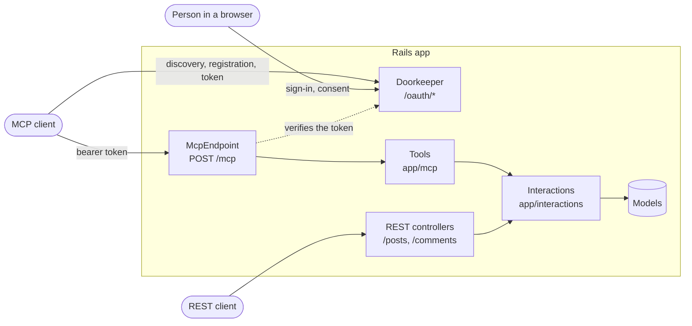
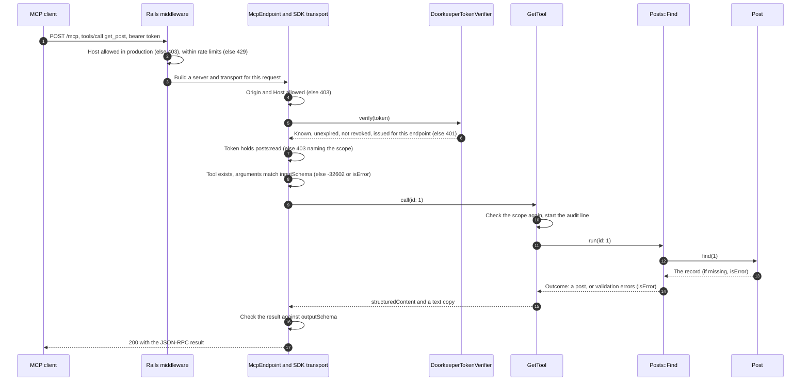
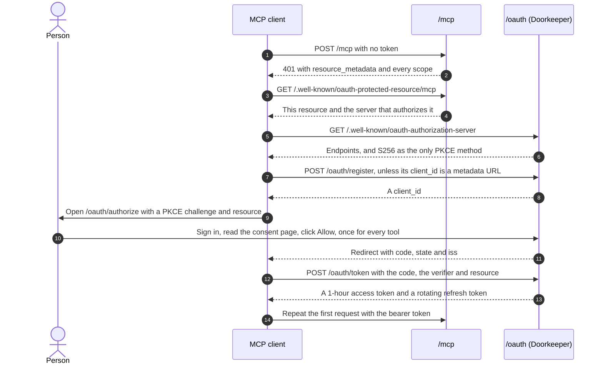

# Rails MCP example

A Rails API whose `Post` CRUD is exposed to AI clients through the
[Model Context Protocol](https://modelcontextprotocol.io/specification/2026-07-28), over
Streamable HTTP, protected by OAuth 2.1. It is meant as an example to copy from.



Rack::Attack rate limits everything inside the box. REST and MCP share the same interactions, so a
rule added there holds for both.

## Run it

You need Docker, and nothing else.

```sh
cp .env.example .env         # the demo sign-in lives here, change it if you like
docker compose up --build    # wait until it says "Listening on"
```

The first start creates the database, the demo user from `.env` and ten sample posts.

**1. Read the reference.** Open <http://localhost:3000/>.

**2. Check that everything works.** In a second terminal, this runs the official SDK client through
sign-in, consent and all ten tools, and prints one line per check:

```sh
docker compose run --rm mcp-check
```

**3. Call a tool by hand.** Get a one-hour token with all scopes, then read the first post:

```sh
TOKEN=$(docker compose exec -T web bin/rails mcp:dev_token)

curl http://localhost:3000/mcp \
  -H "Authorization: Bearer $TOKEN" \
  -H "Content-Type: application/json" \
  -H "Accept: application/json, text/event-stream" \
  -H "MCP-Protocol-Version: 2025-11-25" \
  -d '{"jsonrpc":"2.0","id":1,"method":"tools/call","params":{"name":"get_post","arguments":{"id":1}}}'
```

**4. Connect a real client and sign in.** A browser opens, where you sign in with `SEED_USER_EMAIL` and
`SEED_USER_PASSWORD` from `.env` and approve the access. Add this URL to your client as an HTTP MCP server:

```text
http://localhost:3000/mcp
```

To finish:

```sh
docker compose run --rm test     # the test suite
docker compose down --volumes    # remove everything. Do this too after changing the sign-in in .env
```

Without Docker, with PostgreSQL running: `bin/setup` creates `.env`, the database and the demo data, then
starts the server. `bin/rails test` runs the tests.

## API reference

Open **`/`** on the running app, `http://localhost:3000/` locally. It documents every tool with its
scope, arguments, returned fields and an example, along with the errors and a raw `curl` call.

MCP has no OpenAPI-style file. A client reads the contract live from `tools/list`, and the proposed
[Server Card](https://github.com/modelcontextprotocol/modelcontextprotocol/blob/main/docs/seps/2127-mcp-server-cards.mdx)
leaves tools out on purpose, since they can vary by user. So this app builds its equivalent from the
tool classes that answer that call:

| OpenAPI world | Here |
|---|---|
| Swagger UI, for reading | `GET /`, rendered from the tool classes on every request |
| `openapi.json` | `GET /docs/tools.json`, the exact `tools/list` result |
| The spec file reviewed in pull requests | [`docs/mcp-tools.json`](docs/mcp-tools.json), a committed copy. Regenerate it with `bin/rails mcp:docs`; a test fails when it is stale |
| Swagger UI, "Try it out" | [MCP Inspector](https://modelcontextprotocol.io/docs/tools/inspector): `npx @modelcontextprotocol/inspector@2.12.0 --server-url http://localhost:3000/mcp --transport http` |
| Contract tests | A test calls every documented example against the real endpoint |

For a quick `curl`, `bin/rails mcp:dev_token` prints a one-hour token. It refuses to run outside
development. The page has no JavaScript and loads nothing from elsewhere, because it shares an origin
with the consent page.

## How data flows

One tool call, from the client to the database and back. Every tool follows this path.



How a client gets a token. The first connection asks for every scope, so one consent covers every tool.



The same flows are drawn on the page at `/`. They are written by hand there and here, so change both
when the path changes.

## What is exposed

| Tool | Scope | Does |
|---|---|---|
| `list_posts` | `posts:read` | One page of posts, newest first |
| `get_post` | `posts:read` | One post |
| `create_post` | `posts:write` | Creates a post |
| `update_post` | `posts:write` | Changes the given fields |
| `delete_post` | `posts:delete` | Permanently deletes a post and its comments |
| `list_comments` | `comments:read` | One page of the comments of a post, newest first |
| `get_comment` | `comments:read` | One comment |
| `create_comment` | `comments:write` | Adds a comment to a post |
| `update_comment` | `comments:write` | Replaces the body of a comment |
| `delete_comment` | `comments:delete` | Permanently deletes a comment |

One consent covers all of these: the server tells a client to ask for every scope when it first signs in.
Each tool still checks its own scope on every call. A client that holds too little, because it asked for
less or connected before a new tool was added, gets an HTTP 403 naming the scope and asks the person once more.

| Endpoint | Purpose |
|---|---|
| `GET /`, `GET /docs/tools.json` | The API reference, public and free of data |
| `POST /mcp` | The MCP endpoint |
| `/posts`, `/posts/:id` | REST for posts |
| `/posts/:post_id/comments`, `/comments/:id` | REST for comments: list and create under the post, the rest on the comment |
| `GET /.well-known/oauth-protected-resource/mcp` | Which authorization server protects `/mcp` (RFC 9728) |
| `GET /.well-known/oauth-authorization-server` | Authorization server metadata (RFC 8414) |
| `GET /oauth/authorize`, `POST /oauth/token`, `POST /oauth/revoke` | OAuth 2.1 |
| `POST /oauth/register` | Dynamic client registration (RFC 7591), kept for older clients |
| `GET, POST /oauth/login`, `POST /oauth/logout` | Sign in the person approving a client |

## Where things are

| Path | What it holds |
|---|---|
| `app/interactions/` | The operations. All business logic, used by REST and MCP alike |
| `app/mcp/application_tool.rb` | Base tool: scope check, result mapping, audit log |
| `app/mcp/posts/`, `app/mcp/comments/` | One thin tool per operation, plus the output schema |
| `app/mcp/mcp_endpoint.rb` | Per-request wiring, and the allowlist of exposed tools |
| `app/mcp/doorkeeper_token_verifier.rb` | The only link between MCP and the authorization server |
| `app/mcp/mcp_api_reference.rb`, `app/controllers/docs_controller.rb`, `app/views/docs/` | The API reference at `/` |
| `app/interactions/oauth/` | Client registration, metadata document fetching, retention |
| `app/controllers/oauth/`, `app/views/oauth/` | Login and consent pages |
| `config/initializers/doorkeeper.rb` | Every authorization server decision, with the reason |
| `config/initializers/rack_attack.rb` | Every rate limit |
| `config/mcp.yml` | Public URL, server identity, allowed origins |

## Add a new entity to MCP

A model is not reachable through MCP until you add its tools to an allowlist, so nothing is exposed by
accident. Comments were added exactly this way, so the files below are real and you can copy them.

**1. Decide two things first.**

- **Scopes:** one each for read, write and delete, like `comments:read`, `comments:write` and
  `comments:delete`. People approve them all on one consent page.
- **Ownership:** scopes say what a client may do, not to which records. If a person should only touch
  their own records, add that now: the user id is `server_context.auth_info.subject`.

**2. Create the model and its relation.** Use `scaffold` for REST endpoints too, or `model` for MCP only.

```sh
bin/rails generate scaffold Comment post:references body:text
```

In the migration, make required columns `null: false`. Then set the relation on both sides:

```ruby
# app/models/comment.rb
class Comment < ApplicationRecord
  BODY_MAX_LENGTH = 10_000

  belongs_to :post

  validates :body, presence: true, length: { maximum: BODY_MAX_LENGTH }
end

# app/models/post.rb
has_many :comments, dependent: :destroy
```

For nested REST routes, and a thin controller, see `config/routes.rb` and `app/controllers/comments_controller.rb`.

**3. Write one interaction per operation** in `app/interactions/comments/`. All the logic lives here, and
both REST and MCP call it. An expected failure goes into `errors`, and a missing record raises
`RecordNotFound`, which the tool and the controller both turn into the right answer.

```ruby
# app/interactions/comments/create.rb
module Comments
  class Create < ApplicationInteraction
    integer :post_id
    string :body, default: nil, strip: false

    def execute
      comment = Post.find(post_id).comments.new(body:)
      errors.merge!(comment.errors) unless comment.save
      comment
    end
  end
end
```

For a list, `include KeysetPagination` and return `paginate(scope)`: see `app/interactions/comments/list.rb`.

**4. Describe what the tools return**, once, in `app/mcp/comments/tool_payload.rb`: an output schema, a
serializer that matches it, and an example.

**5. Write one thin tool per operation** in `app/mcp/comments/`. It declares its contract and calls the
interaction. The base class handles the scope check, errors and the audit log.

```ruby
# app/mcp/comments/create_tool.rb
module Comments
  class CreateTool < ApplicationTool
    tool_name "create_comment"
    title "Create comment"
    description "Adds a comment to a post."
    required_scope "comments:write"
    annotations(read_only_hint: false, destructive_hint: false, idempotent_hint: false, open_world_hint: false)
    input_schema(
      properties: {
        post_id: { type: "integer", minimum: 1 },
        body: { type: "string", minLength: 1, maxLength: Comment::BODY_MAX_LENGTH }
      },
      required: %w[ post_id body ],
      additionalProperties: false
    )
    output_schema(ToolPayload::COMMENT)
    example arguments: { post_id: 1, body: "Nice post" }, result: ToolPayload::EXAMPLE

    def self.perform(**arguments)
      respond_with(Create.run(arguments)) { |comment| ToolPayload.comment(comment) }
    end
  end
end
```

Set the annotations honestly, because clients use them to decide when to ask a person first: an update
that overwrites content is destructive. Models read the descriptions, so say what the tool does and what
it cannot do. The body is written by users, so `McpEndpoint::INSTRUCTIONS` should tell clients to treat it
as data.

**6. Expose the tools** by adding them to `TOOLS` in `app/mcp/mcp_endpoint.rb`.

**7. Add the scopes** to `default_scopes` in `config/initializers/doorkeeper.rb`, and the text the consent
page shows to `config/locales/oauth.en.yml`. New sign-ins then ask for them too. A client that is already
connected asks the person once more, the first time it calls a new tool.

**8. Regenerate the contract.** The tools now appear on the page at `/` by themselves.

```sh
bin/rails mcp:docs
```

**9. Add tests.** Add a fixture named `one` to `test/fixtures/comments.yml`, and the shared tests will call
your documented examples against it. Copy `test/integration/mcp_comment_tools_test.rb` for the rest:
the lifecycle, missing records, validation errors and each scope.

**10. Add seeds, then try it.** Add sample records to `db/seeds.rb`. Restart to load the new folders and
initializer, and to run the migration and seeds, then open `/`:

```sh
docker compose restart web
```

**If you miss a step**, this is what tells you:

| You forgot | What happens |
|---|---|
| Step 6, `TOOLS` | The tool does not exist for clients. No test fails, because being left out is the safe default |
| `example`, or a closed `input_schema` | `mcp_tools_test.rb` or `mcp_api_reference_test.rb` fails, and the page at `/` raises an error for a missing example |
| Step 7, the scope | `mcp_tools_test.rb` fails: the tool needs an unknown scope |
| Step 7, the consent text | `mcp_tools_test.rb` fails: the scope has no label |
| Step 8, `mcp:docs` | `mcp_api_reference_test.rb` fails: `docs/mcp-tools.json` is stale |
| A wrong example | `mcp_api_reference_test.rb` fails: it calls each example on the real endpoint |

## Reusing it

**Expose another model.** See [Add a new entity to MCP](#add-a-new-entity-to-mcp).

**Use an external identity provider (Keycloak, Auth0, ...).** Replace `DoorkeeperTokenVerifier` in
`McpEndpoint` with the SDK's `MCP::Server::OAuth::JWTVerifier` or `IntrospectionVerifier`, and point
`authorization_servers` in `config/initializers/mcp.rb` at the provider. Then remove Doorkeeper,
`app/controllers/oauth/`, `app/views/oauth/`, `app/interactions/oauth/` and the `use_doorkeeper` routes.
No tool changes.

**Copy it into another app.** Take `app/mcp/`, `app/interactions/`, the OAuth files above,
`config/mcp.yml`, the initializers, the migrations, and the session settings in `config/application.rb`.

## Security

| Risk | Control | Where |
|---|---|---|
| A token issued for another service is replayed here | Tokens are bound to this endpoint (RFC 8707) and checked on every request | `DoorkeeperTokenVerifier` |
| A stolen authorization code | S256 PKCE on every client, short-lived and single-use codes; a replay revokes what the code issued | Doorkeeper initializer |
| A stolen token | 1 hour access tokens, refresh tokens that rotate on every use, immediate revocation | Doorkeeper initializer |
| A database leak | Tokens stored as SHA-256 digests, client secrets and passwords with bcrypt | Doorkeeper initializer, `User` |
| A tool running without permission | The scope is checked at the HTTP layer and again in the tool, on every call. One consent grants every scope, so a person approves all access at once. A client can still ask for less | `ApplicationTool`, `McpEndpoint`, Doorkeeper initializer |
| Redirect to an attacker | Exact match against registered URIs, except the port of a loopback redirect (RFC 8252); https or loopback only | `Oauth::RedirectUriPolicy` |
| Authorization server mix-up | `iss` in every authorization response (RFC 9207) | Doorkeeper initializer |
| A client lying about itself | Never-skipped consent showing the redirect host, with a warning for self-registered and loopback clients | `app/views/oauth/authorizations/new.html.erb` |
| DNS rebinding, forged Host | Origin and Host validated by the transport; `config.hosts` in production | `McpEndpoint`, `production.rb` |
| SSRF through a URL `client_id` | https on 443 only, public addresses only, connection pinned to the checked address, no redirects, no proxies, bounded time and size | `Oauth::FetchClientMetadataDocument` |
| CSRF, clickjacking, session fixation | CSRF tokens, CSP `frame-ancestors 'none'`, a new session at login, a `SameSite=Lax` cookie scoped to `/oauth` | `Oauth::BrowserController`, `Oauth::SessionsController` |
| Brute force, abuse, runaway agents | Rate limits by address, account and token, shared across the fleet | `config/initializers/rack_attack.rb` |
| Oversized or malicious input | A 1 MiB body limit, closed JSON schemas with length limits, typed interaction inputs | `McpEndpoint`, the tools, the interactions |
| Secrets or content in logs | Tool arguments are never logged, OAuth values are filtered; an audit line records who called what | `McpEndpoint`, `ApplicationTool` |
| Internals leaking to clients | Unexpected errors are reported to `Rails.error`, the client gets a generic message | `ApplicationTool` |
| Prompt injection through post content | The server instructions tell clients that post text is data. This reduces the risk, it does not remove it: a client must still keep a person in the loop for destructive tools, which are annotated as such | `McpEndpoint` |
| Unbounded data growth | A daily purge of stale tokens, grants and unused self-registered clients | `PurgeStaleOauthRecordsJob` |

## Before you deploy

1. **Protect or remove the REST API.** `/posts` and `/comments` have no authentication, as generated by the scaffold.
   Anyone can read and change what MCP protects with OAuth.
2. **Decide who may touch which record.** Scopes say what a client may do, and any signed-in person
   can approve any scope for all records. Posts and comments have no owner in this sample. For per-record rules, pass
   the user into the interactions (`auth_info.subject` holds the user id).
3. Set `MCP_PUBLIC_URL` (see `.env.example`). The app refuses to boot without an https URL.
4. Create the accounts, since there is no sign-up: `User.create!(email_address:, password:)`.
5. Decide whether the reference at `/` stays public. It holds no data, but it does show your tools
   and scopes to anyone. To hide it, remove the `root` and `docs/tools.json` routes in `config/routes.rb`.

## Known limits

- **Doorkeeper is a release candidate** (`6.0.0.rc2`). Stable 5.9.9 has no native RFC 8707, RFC 8414 or
  RFC 9207 support and matches redirect URIs loosely. Move to `~> 6.0` when 6.0.0 ships.
- **No streaming.** Responses are single JSON objects. That is valid Streamable HTTP and scales simply,
  but rules out server-to-client requests and progress notifications. `GET /mcp` answers 405.
- **No CORS.** Clients running in a browser cannot call the API until `rack-cors` is added for the
  origins in `MCP_ALLOWED_ORIGINS`. Desktop, CLI and server-side clients are unaffected.
- **Refresh token reuse** is refused, but does not revoke the rest of that client's tokens.
- **Client ID Metadata Documents** have been exercised against one real host's published document, and otherwise by tests against a
  local socket and stubbed DNS.
