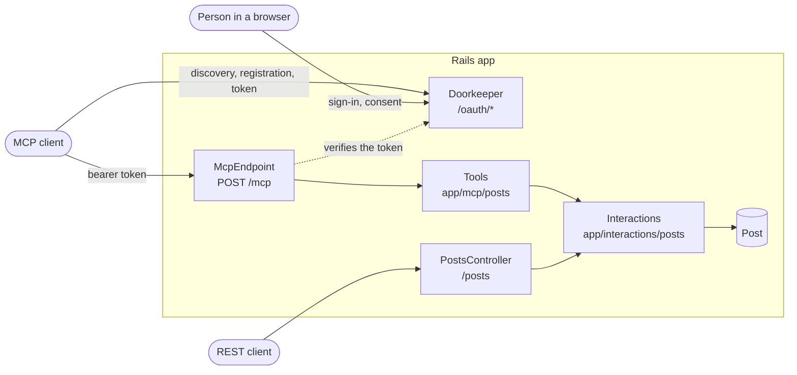
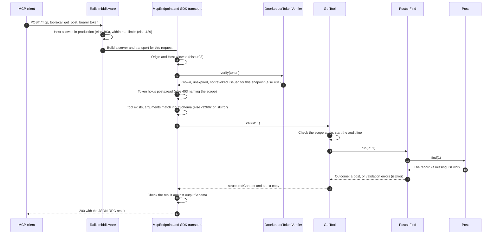
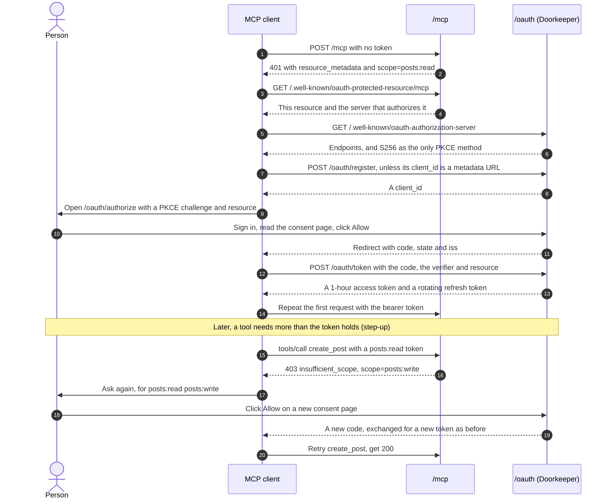

# Rails MCP example

A Rails API whose `Post` CRUD is exposed to AI clients through the
[Model Context Protocol](https://modelcontextprotocol.io/specification/2026-07-28), over
Streamable HTTP, protected by OAuth 2.1. It is meant as an example to copy from.



Rack::Attack rate limits everything inside the box. REST and MCP share the same interactions, so a
rule added there holds for both.

## Run it

You need Docker, and nothing else.

```sh
cp .env.example .env         # the demo sign-in lives here, change it if you like
docker compose up --build    # wait until it says "Listening on"
```

The first start creates the database, the demo user from `.env` and ten sample posts.

**1. Read the reference.** Open <http://localhost:3000/>.

**2. Check that everything works.** In a second terminal, this runs the official SDK client through
sign-in, consent and all five tools, and prints one line per check:

```sh
docker compose run --rm mcp-check
```

**3. Call a tool by hand.** Get a one-hour token with all scopes, then read the first post:

```sh
TOKEN=$(docker compose exec -T web bin/rails mcp:dev_token)

curl http://localhost:3000/mcp \
  -H "Authorization: Bearer $TOKEN" \
  -H "Content-Type: application/json" \
  -H "Accept: application/json, text/event-stream" \
  -H "MCP-Protocol-Version: 2025-11-25" \
  -d '{"jsonrpc":"2.0","id":1,"method":"tools/call","params":{"name":"get_post","arguments":{"id":1}}}'
```

**4. Connect a real client and sign in.** A browser opens, where you sign in with `SEED_USER_EMAIL` and
`SEED_USER_PASSWORD` from `.env` and approve the access. Add this URL to your client as an HTTP MCP server:

```text
http://localhost:3000/mcp
```

To finish:

```sh
docker compose run --rm test     # the test suite
docker compose down --volumes    # remove everything. Do this too after changing the sign-in in .env
```

Without Docker, with PostgreSQL running: `bin/setup` creates `.env`, the database and the demo data, then
starts the server. `bin/rails test` runs the tests.

## API reference

Open **`/`** on the running app, `http://localhost:3000/` locally. It documents every tool with its
scope, arguments, returned fields and an example, along with the errors and a raw `curl` call.

MCP has no OpenAPI-style file. A client reads the contract live from `tools/list`, and the proposed
[Server Card](https://github.com/modelcontextprotocol/modelcontextprotocol/blob/main/docs/seps/2127-mcp-server-cards.mdx)
leaves tools out on purpose, since they can vary by user. So this app builds its equivalent from the
tool classes that answer that call:

| OpenAPI world | Here |
|---|---|
| Swagger UI, for reading | `GET /`, rendered from the tool classes on every request |
| `openapi.json` | `GET /docs/tools.json`, the exact `tools/list` result |
| The spec file reviewed in pull requests | [`docs/mcp-tools.json`](docs/mcp-tools.json), a committed copy. Regenerate it with `bin/rails mcp:docs`; a test fails when it is stale |
| Swagger UI, "Try it out" | [MCP Inspector](https://modelcontextprotocol.io/docs/tools/inspector): `npx @modelcontextprotocol/inspector@2.12.0 --server-url http://localhost:3000/mcp --transport http` |
| Contract tests | A test calls every documented example against the real endpoint |

For a quick `curl`, `bin/rails mcp:dev_token` prints a one-hour token. It refuses to run outside
development. The page has no JavaScript and loads nothing from elsewhere, because it shares an origin
with the consent page.

## How data flows

One tool call, from the client to the database and back. Every tool follows this path.



How a client gets a token, and more access later. The first connection asks for the base scope only.



The same flows are drawn on the page at `/`. They are written by hand there and here, so change both
when the path changes.

## What is exposed

| Tool | Scope | Does |
|---|---|---|
| `list_posts` | `posts:read` | One page of posts, newest first |
| `get_post` | `posts:read` | One post |
| `create_post` | `posts:write` | Creates a post |
| `update_post` | `posts:write` | Changes the given fields |
| `delete_post` | `posts:delete` | Permanently deletes a post |

A client first asks for `posts:read` only. When it calls a tool that needs more, it gets an
HTTP 403 naming the scope, asks the person again, and retries (step-up authorization).

| Endpoint | Purpose |
|---|---|
| `GET /`, `GET /docs/tools.json` | The API reference, public and free of data |
| `POST /mcp` | The MCP endpoint |
| `GET /.well-known/oauth-protected-resource/mcp` | Which authorization server protects `/mcp` (RFC 9728) |
| `GET /.well-known/oauth-authorization-server` | Authorization server metadata (RFC 8414) |
| `GET /oauth/authorize`, `POST /oauth/token`, `POST /oauth/revoke` | OAuth 2.1 |
| `POST /oauth/register` | Dynamic client registration (RFC 7591), kept for older clients |
| `GET, POST /oauth/login`, `POST /oauth/logout` | Sign in the person approving a client |

## Where things are

| Path | What it holds |
|---|---|
| `app/interactions/` | The operations. All business logic, used by REST and MCP alike |
| `app/mcp/application_tool.rb` | Base tool: scope check, result mapping, audit log |
| `app/mcp/posts/` | One thin tool per operation, plus the output schema |
| `app/mcp/mcp_endpoint.rb` | Per-request wiring, and the allowlist of exposed tools |
| `app/mcp/doorkeeper_token_verifier.rb` | The only link between MCP and the authorization server |
| `app/mcp/mcp_api_reference.rb`, `app/controllers/docs_controller.rb`, `app/views/docs/` | The API reference at `/` |
| `app/interactions/oauth/` | Client registration, metadata document fetching, retention |
| `app/controllers/oauth/`, `app/views/oauth/` | Login and consent pages |
| `config/initializers/doorkeeper.rb` | Every authorization server decision, with the reason |
| `config/initializers/rack_attack.rb` | Every rate limit |
| `config/mcp.yml` | Public URL, server identity, base scope, allowed origins |

## Reusing it

**Expose another model.** Write the operations as interactions, then one tool per operation:

```ruby
# app/interactions/comments/create.rb
module Comments
  class Create < ApplicationInteraction
    integer :post_id
    string :text

    def execute
      comment = Comment.new(inputs)
      errors.merge!(comment.errors) unless comment.save
      comment
    end
  end
end

# app/mcp/comments/create_tool.rb
module Comments
  class CreateTool < ApplicationTool
    tool_name "create_comment"
    description "Adds a comment to a post."
    required_scope "comments:write"
    annotations(read_only_hint: false, destructive_hint: false, idempotent_hint: false, open_world_hint: false)
    input_schema(
      properties: { post_id: { type: "integer" }, text: { type: "string", maxLength: 2000 } },
      required: %w[ post_id text ],
      additionalProperties: false
    )
    output_schema(
      properties: { id: { type: "integer" }, text: { type: "string" } },
      required: %w[ id text ],
      additionalProperties: false
    )
    example arguments: { post_id: 1, text: "Nice" }, result: { id: 1, text: "Nice" }

    def self.perform(**arguments)
      respond_with(Create.run(arguments)) { |comment| { id: comment.id, text: comment.text } }
    end
  end
end
```

Then add the tool to `McpEndpoint::TOOLS`, the scope to `optional_scopes` in the Doorkeeper
initializer, and its label to `config/locales/oauth.en.yml`, and run `bin/rails mcp:docs`. The new tool
appears on the page at `/` by itself. `test/integration/mcp_tools_test.rb` checks that every listed tool
declares a known scope and a closed input schema, and `mcp_api_reference_test.rb` calls its example.

**Use an external identity provider (Keycloak, Auth0, ...).** Replace `DoorkeeperTokenVerifier` in
`McpEndpoint` with the SDK's `MCP::Server::OAuth::JWTVerifier` or `IntrospectionVerifier`, and point
`authorization_servers` in `config/initializers/mcp.rb` at the provider. Then remove Doorkeeper,
`app/controllers/oauth/`, `app/views/oauth/`, `app/interactions/oauth/` and the `use_doorkeeper` routes.
No tool changes.

**Copy it into another app.** Take `app/mcp/`, `app/interactions/`, the OAuth files above,
`config/mcp.yml`, the initializers, the migrations, and the session settings in `config/application.rb`.

## Security

| Risk | Control | Where |
|---|---|---|
| A token issued for another service is replayed here | Tokens are bound to this endpoint (RFC 8707) and checked on every request | `DoorkeeperTokenVerifier` |
| A stolen authorization code | S256 PKCE on every client, short-lived and single-use codes; a replay revokes what the code issued | Doorkeeper initializer |
| A stolen token | 1 hour access tokens, refresh tokens that rotate on every use, immediate revocation | Doorkeeper initializer |
| A database leak | Tokens stored as SHA-256 digests, client secrets and passwords with bcrypt | Doorkeeper initializer, `User` |
| Too much access | Least privilege per tool, the scope checked at the HTTP layer and again in the tool | `ApplicationTool`, `McpEndpoint` |
| Redirect to an attacker | Exact match against registered URIs, https or loopback only | `Oauth::RedirectUriPolicy` |
| Authorization server mix-up | `iss` in every authorization response (RFC 9207) | Doorkeeper initializer |
| A client lying about itself | Never-skipped consent showing the redirect host, with a warning for self-registered and loopback clients | `app/views/oauth/authorizations/new.html.erb` |
| DNS rebinding, forged Host | Origin and Host validated by the transport; `config.hosts` in production | `McpEndpoint`, `production.rb` |
| SSRF through a URL `client_id` | https on 443 only, public addresses only, connection pinned to the checked address, no redirects, no proxies, bounded time and size | `Oauth::FetchClientMetadataDocument` |
| CSRF, clickjacking, session fixation | CSRF tokens, CSP `frame-ancestors 'none'`, a new session at login, a `SameSite=Lax` cookie scoped to `/oauth` | `Oauth::BrowserController`, `Oauth::SessionsController` |
| Brute force, abuse, runaway agents | Rate limits by address, account and token, shared across the fleet | `config/initializers/rack_attack.rb` |
| Oversized or malicious input | A 1 MiB body limit, closed JSON schemas with length limits, typed interaction inputs | `McpEndpoint`, the tools, the interactions |
| Secrets or content in logs | Tool arguments are never logged, OAuth values are filtered; an audit line records who called what | `McpEndpoint`, `ApplicationTool` |
| Internals leaking to clients | Unexpected errors are reported to `Rails.error`, the client gets a generic message | `ApplicationTool` |
| Prompt injection through post content | The server instructions tell clients that post text is data. This reduces the risk, it does not remove it: a client must still keep a person in the loop for destructive tools, which are annotated as such | `McpEndpoint` |
| Unbounded data growth | A daily purge of stale tokens, grants and unused self-registered clients | `PurgeStaleOauthRecordsJob` |

## Before you deploy

1. **Protect or remove the REST API.** `/posts` has no authentication, as generated by the scaffold.
   Anyone can read and change what MCP protects with OAuth.
2. **Decide who may touch which post.** Scopes say what a client may do, and any signed-in person
   can approve any scope for all posts. Posts have no owner in this sample. For per-record rules, pass
   the user into the interactions (`auth_info.subject` holds the user id).
3. Set `MCP_PUBLIC_URL` (see `.env.example`). The app refuses to boot without an https URL.
4. Create the accounts, since there is no sign-up: `User.create!(email_address:, password:)`.
5. Decide whether the reference at `/` stays public. It holds no data, but it does show your tools
   and scopes to anyone. To hide it, remove the `root` and `docs/tools.json` routes in `config/routes.rb`.

## Known limits

- **Doorkeeper is a release candidate** (`6.0.0.rc2`). Stable 5.9.9 has no native RFC 8707, RFC 8414 or
  RFC 9207 support and matches redirect URIs loosely. Move to `~> 6.0` when 6.0.0 ships.
- **No streaming.** Responses are single JSON objects. That is valid Streamable HTTP and scales simply,
  but rules out server-to-client requests and progress notifications. `GET /mcp` answers 405.
- **No CORS.** Clients running in a browser cannot call the API until `rack-cors` is added for the
  origins in `MCP_ALLOWED_ORIGINS`. Desktop, CLI and server-side clients are unaffected.
- **Refresh token reuse** is refused, but does not revoke the rest of that client's tokens.
- **Client ID Metadata Documents** are covered by tests against a local socket and stubbed DNS. Fetching
  from a real https host has not been exercised.
